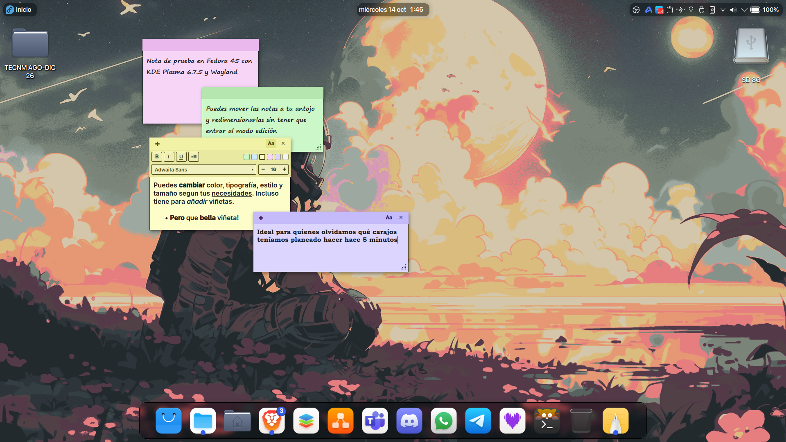
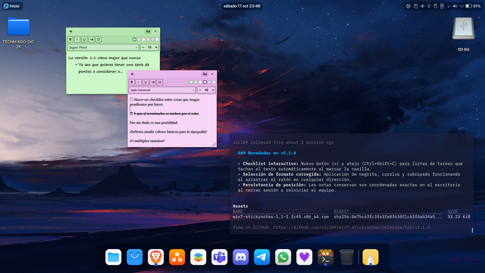

# Win7 Sticky Notes for KDE Plasma 6

Un widget de notas adhesivas (*Sticky Notes*) para **KDE Plasma 6**, diseñado para replicar con total fidelidad la estética y experiencia de las clásicas notas de Windows 7 Aero[cite: 1, 3].




## ✨ Características principales

* **Estética Clásica de Windows 7:** Franja superior ligeramente más oscura con botones de control integrados y textura punteada de redimensionado en la esquina inferior derecha[cite: 1, 3].
* **6 Temas de Color Pastel:** Verde, Azul, Amarillo, Rosa, Morado y Blanco con adaptabilidad automática de alto contraste en los elementos de la interfaz[cite: 3].
* **Formato Enriquecido y Atajos:** Soporta **Negrita** (`Ctrl+B`), *Cursiva* (`Ctrl+I`), <u>Subrayado</u> (`Ctrl+U`) y listas con viñetas (`Ctrl+Shift+L`).
* **Tipografías y Tamaños Personalizables:** Selector de fuentes del sistema integrado y control rápido de tamaño.
* **Creación Instantánea:** Botón `+` para desplegar nuevas notas en cascada de forma inmediata.
* **Movimiento y Redimensionado Libre:** Arrastre fluido desde la barra superior y ajuste de dimensiones interactivo desde la esquina sin restricciones del escritorio.
* **Backend Nativo en C++ / Qt 6:** Alto rendimiento y persistencia independiente por cada instancia de nota mediante un plugin optimizado (`ECM QML Module`).

---

## 🛠️ Requisitos de Compilación

Para compilar e instalar este plasmoide desde el código fuente, necesitas las siguientes herramientas de desarrollo en tu sistema:

### En Fedora / RHEL / OpenMandriva:
```bash
sudo dnf install cmake extra-cmake-modules gcc-c++ qt6-qtbase-devel qt6-qtdeclarative-devel kf6-kpackage-devel qt6-qt5compat

### En Ubuntu / KDE Neon / Debian:
```bash
sudo apt install cmake extra-cmake-modules g++ qt6-base-dev qt6-declarative-dev libkf6package-dev qt6-5compat-dev

---

### COMPILACIÓN E INSTALACIÓN MANUAL
```bash
git clone [https://github.com/TU_USUARIO/win7-stickynotes.git](https://github.com/TU_USUARIO/win7-stickynotes.git)
cd win7-stickynotes
mkdir build && cd build
cmake .. -DCMAKE_INSTALL_PREFIX=/usr -DCMAKE_BUILD_TYPE=Release
make -j$(nproc)
sudo make install
rm -rf ~/.cache/plasmashell/qmlcache/*
systemctl --user restart plasma-plasmashell.service

### INSTALACIÓN MEDIANTE PAQUETE RPM (Fedora)
```bash
sudo dnf install win-7-stickynotes-1.0.1.fc*.x86_64.rpm
